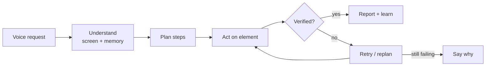

## Context

I wanted to use my laptop without touching it: while eating, cooking, or with my hands otherwise busy. Windows has voice tools, but they follow fixed commands and can't see what's on the screen. The goal was an assistant that behaves like a capable person sitting next to you: you say what you want, it figures out the steps, does them, and tells you honestly whether it worked.

## The problem

- **Voice tools are blind.** They can't see buttons, fields or tabs, so you have to describe every step.
- **Simple tasks take many steps.** Switch tab, click the search box, type, press Enter, scroll.
- **Generic assistants guess.** They often report success without checking, so you still have to look at the screen yourself.

## Approach & process

**Key decisions**

- **General, not scripted.** No hardcoded recipes like "new tab → Ctrl+T". The model chooses from generic actions (open app, switch window, click, type, scroll) based on your words and the screen, so it handles tasks it was never programmed for.
- **Short speech, rich screen.** Spoken replies stay at one to three words or one sentence. The detail (what it heard, planned and did) goes to a live dashboard.
- **A desktop app, not a script.** FastAPI backend, React dashboard in a native window, packaged as a single Windows `.exe`. API keys are entered on first run and never bundled.

**Testing on real tasks**

I ran a live session of about 95 voice turns on everyday tasks (opening apps, switching tabs, searching Amazon, filling a sign-in form) and reviewed every turn.

| What I measured | Result |
| --- | --- |
| Turns spent correcting the assistant | ~42% |
| Actions reported "done" without checking | Several |
| Turns lost to API rate limits or bad output | 5 |
| Specific issues found | 17, each traced to a root cause |


Most failures weren't the model being "not smart enough". They came from three gaps: **no memory of the current task**, **no check after each action**, and **screen data read as raw text and coordinates** instead of real buttons and fields.


That changed the plan from "use a bigger model" to "build a verify loop":

**Trade-offs**

- **Plain code over the LLM where precision matters.** Spoken digits, filtering out its own voice, and scroll direction are handled by deterministic code: faster, cheaper and never "creative".
- **Elements over screenshots.** Reading real interface elements (Windows UI Automation, a Chrome extension) is more reliable than clicking coordinates from a screenshot; vision stays as a fallback.
- **Ask one question, not many.** When unsure, it asks a single specific question, and only if the screen can't answer it.

## The solution

**What Sensei does today**

- **Continuous voice conversation** with a wake name; talking over it stops its speech.
- **Screen awareness:** answers questions about what's on screen and uses it to target actions.
- **PC control:** opens apps, switches windows, clicks, types and scrolls from a single spoken request.
- **Voice-drafted replies:** composes Slack and email replies straight to the clipboard.
- **Live dashboard:** shows each request, its planned steps, every action and its result.

**Currently adding:** element-level screen reading, memory of the current task across turns, a check after every action, and spoken confirmation before risky steps like sending or buying.

## Impact

- **Shipped a working desktop app:** voice loop, screen awareness, PC control and dashboard in one Windows installer.
- **Measured instead of guessed:** a 95-turn live test gave a clear baseline and 17 tracked issues, each linked to a fix.
- **Defined success up front:** under 10% correction turns, zero unverified "done" claims, and zero turns lost to API errors.

## What I learned

- Reliability problems are usually missing structure (memory, verification, clean data), not missing intelligence.
- An LLM should never decide what a past action did; the action log should.
- Testing with real tasks early is worth more than another week of building.
